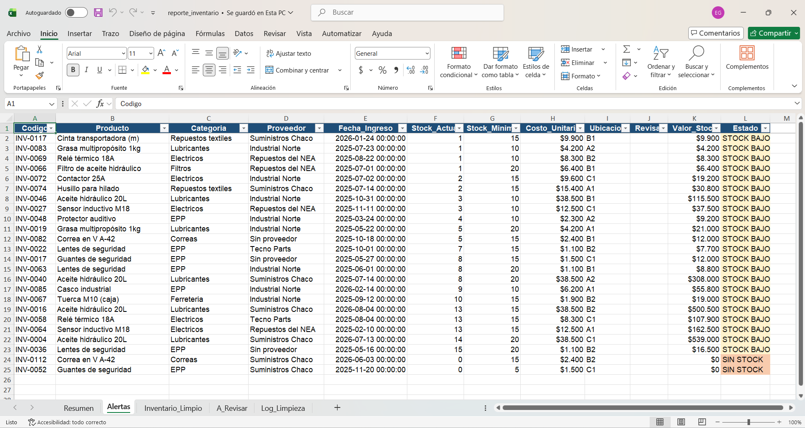

# 📦 Limpieza y reporte automático de inventario (Python + Excel)

Script en Python que toma una planilla de inventario con errores típicos de carga manual, la limpia automáticamente y genera un reporte en Excel listo para usar: alertas de reposición, resumen por categoría y un registro de todo lo que se corrigió.

> **Nota:** todos los datos de este proyecto son **simulados**. No pertenecen a ninguna empresa real.

---

## 🎯 El problema

En muchas plantas y comercios, el inventario se carga a mano en Excel y termina con errores que hacen difícil confiar en los números:

- Filas duplicadas
- Fechas escritas en distintos formatos (`25/01/2026`, `25-01-26`, `2026.01.25`)
- Costos guardados como texto (`$1,850`)
- Categorías con mayúsculas y espacios inconsistentes (`" ELECTRICOS"`, `"filtros "`)
- Proveedores vacíos o con `N/A`
- Stock vacío, con texto (`"s/d"`, `"12 unid."`) o negativo

## ✅ La solución

El script `limpiar_inventario.py` corrige estos errores y produce `reporte_inventario.xlsx` con 5 hojas:

| Hoja | Contenido |
|---|---|
| **Resumen** | Productos, unidades, valor total y cantidad de alertas por categoría |
| **Alertas** | Productos sin stock o por debajo del mínimo, con colores (rojo = sin stock, amarillo = stock bajo) |
| **Inventario_Limpio** | Todos los datos corregidos, con valor de stock calculado y filtros |
| **A_Revisar** | Filas con datos que no se pueden corregir de forma segura (stock negativo o ilegible). **No se adivinan: se marcan para revisión humana** |
| **Log_Limpieza** | Cuántas correcciones se hicieron de cada tipo |

## 📊 Resultado con los datos de ejemplo

| Control | Cantidad |
|---|---|
| Filas al inicio | 127 |
| Duplicados eliminados | 7 |
| Categorías corregidas | 10 |
| Proveedores vacíos marcados | 8 |
| Filas limpias en el reporte | 112 |
| Filas enviadas a revisión manual | 8 |



## 🚀 Cómo usarlo

**Requisitos:** Python 3.9 o superior.

```bash
# 1. Instalar las librerías
pip install -r requirements.txt

# 2. Ejecutar el script indicando el archivo a limpiar
python limpiar_inventario.py inventario_sucio.xlsx
```

Se genera `reporte_inventario.xlsx` en la misma carpeta.

Para usarlo con tu propia planilla, debe tener estas columnas:
`Codigo`, `Producto`, `Categoria`, `Proveedor`, `Fecha_Ingreso`, `Stock_Actual`, `Stock_Minimo`, `Costo_Unitario`, `Ubicacion`.

## 📁 Archivos del proyecto

```
├── limpiar_inventario.py     # Script principal (limpieza + reporte)
├── generar_datos.py          # Genera los datos simulados de prueba
├── inventario_sucio.xlsx     # Ejemplo de entrada, con errores
├── reporte_inventario.xlsx   # Ejemplo de salida
└── requirements.txt          # Dependencias
```

## 🛠️ Tecnologías

Python · pandas · openpyxl · Excel

## 🔧 Posibles mejoras

- Enviar el reporte por mail de forma automática
- Conectar a una base de datos (SQL) en lugar de un archivo Excel
- Agregar gráficos al reporte
- Ejecutarlo de forma programada (por ejemplo, todos los lunes)

---

## 🇺🇸 English summary

Python script that cleans a messy inventory spreadsheet (duplicates, mixed date formats, text-stored numbers, inconsistent categories, missing suppliers, invalid stock) and generates a formatted Excel report with low-stock alerts, a category summary and a cleaning log. Records that cannot be fixed safely are flagged for manual review instead of guessed. All data is simulated.

**Usage:** `pip install -r requirements.txt` then `python limpiar_inventario.py inventario_sucio.xlsx`

---

## 👤 Autor

**Esteban González** · Estudiante de Ingeniería Electromecánica (UTN FRRe) · Análisis de datos y automatización de reportes
📍 Chaco, Argentina
🔗 [LinkedIn](https://www.linkedin.com/) <!-- reemplazá por el link a tu perfil -->
